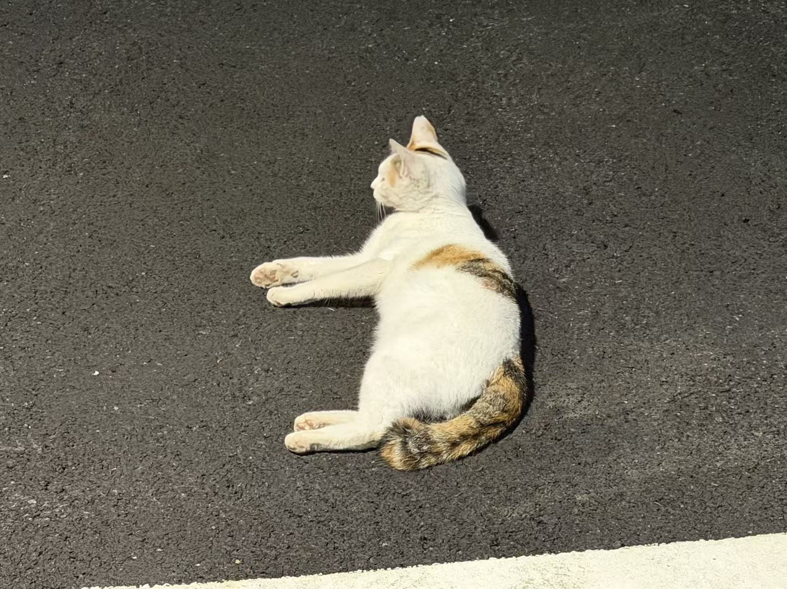

# vision01
computer vision lesson1 practise
This is my first image processing exercise.

## What Was Done
- Read an image using OpenCV
- Size of the printed image
- Display images and save the results

## How to Run
1. Install dependencies: `pip install numpy opencv-python`
2. Place the image in the images folder.
3. Run: `python code/first.py`

## Results

